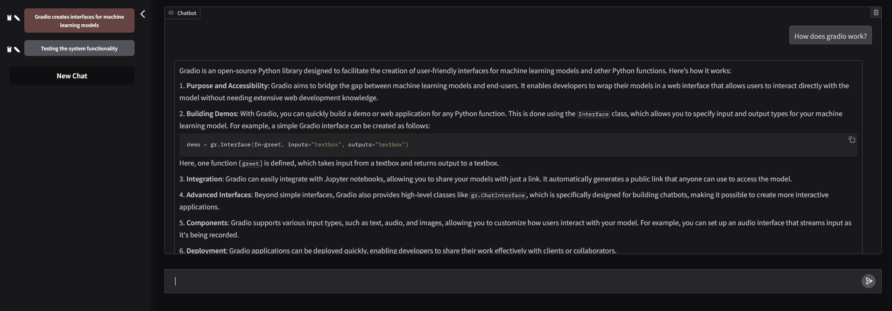

A template for chatbot streaming from langgraph with gradio

The template features history for the LLM, a couple tool calls, streaming output, tabs, persistence, and follow-up question buttons.

# Install

    pip install uv

Add your Google Gemini API key to `.env` as `GOOGLE_API_KEY`.
Optionally add tavily key for websearch
Set `GRADIO_BROWSER_STORAGE_SECRET` in `.env` to a stable random value to preserve browser state across server restarts.

# Run

    uv run app.py
